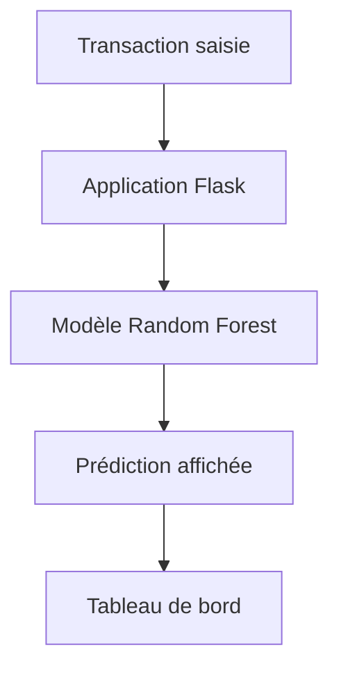

# Détection de fraudes bancaires par machine learning

**Projet de fin d’année de 3ᵉ année · EMSI · 2024–2025**

Une application Flask qui analyse les caractéristiques d’une transaction par carte et signale les transactions potentiellement frauduleuses. Le projet couvre la préparation des données, la comparaison de modèles et l’intégration du modèle retenu dans une interface web.

## Démonstration

1. Saisir le montant de la transaction et les composantes anonymisées demandées dans le formulaire.
2. Lancer l’analyse. L’application affiche la classe prédite et signale les transactions suspectes.
3. Ouvrir le tableau de bord pour consulter le nombre de transactions analysées et la répartition des prédictions.

## Données et méthode

Le projet utilise le jeu de données [Credit Card Fraud Detection de l’ULB, publié sur Kaggle](https://www.kaggle.com/datasets/mlg-ulb/creditcardfraud). Les variables anonymisées proviennent d’une analyse en composantes principales. Les fraudes représentent moins de 0,2 % des transactions, d’où l’intérêt de mesurer la précision et le rappel de la classe frauduleuse.

- Standardisation des variables numériques, dont le montant de la transaction.
- Rééquilibrage de l’ensemble d’entraînement avec **SMOTE**, qui génère des exemples synthétiques de la classe minoritaire.
- Comparaison de **Random Forest** et **SVM**, puis sélection de Random Forest.
- Sérialisation du modèle avec **joblib** pour l’intégrer à Flask.

## Résultats

La section 4.1 du rapport donne les scores suivants pour Random Forest sur l’ensemble de test.

| Métrique | Score |
| --- | ---: |
| Précision | 0,99 |
| Rappel | 0,97 |
| F1 | 0,98 |

Le prototype est conçu pour aider à examiner les transactions suspectes. Le tableau de bord agrège les classes prédites par le modèle.

## Technologies

| Partie | Outils |
| --- | --- |
| Préparation des données et entraînement | Python, pandas, NumPy, scikit-learn, imbalanced-learn |
| Application web et intégration du modèle | Flask, joblib |
| Interface et graphiques | HTML, CSS, JavaScript, Bootstrap, Chart.js |

## Équipe

- **Zainab Belgas**
- **Ilham Afouaar**

**Encadrement** — Soufiane Hamida, EMSI.
